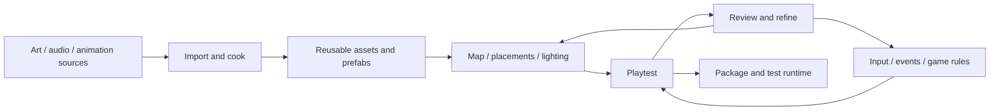

# From a scene to a playable game

Rime is pre-alpha. This guide describes the working editor paths, explains the
production workflow they are growing toward, and names the missing pieces.
Start with a tiny complete interaction, then grow the map around it.

## Open Frost Yard

From the repository root, run:

```sh
./scripts/thermal-courtyard.sh --editor
```

This builds the C++ sample and Rust GUI and supplies the courtyard-specific host
and scene. The first build can take time; keep the terminal open for errors.
If the window shows the courtyard and Play/Pause work, the launcher succeeded.
An existing window keeps its old binary: close it and rerun after an update.
For a simple standalone demonstration, omit `--editor`.

## Open the city with weapons and run the game

```sh
./scripts/city-editor.sh
```

This opens the expanded city in the native editor. Its persistent map is
`build/release/city-editor.rscene`; subsequent launches preserve your edits.
Use `./scripts/city-editor.sh --scene /absolute/path/map.rscene` to open an
existing map. The launcher supplies the game's component/preview host and cooks.

Press **Run game** in the top toolbar. The editor saves the current document,
waits for success, then opens the full city game in a separate window. A save
refusal never launches an older copy. Stop editor Preview first if Run is disabled.
The bottom status shows launch/exit information; hover for the game's output log.
Closing the editor leaves the launched game running; Escape closes that game.

In the game: **WASD** moves, mouse looks, **left mouse** shoots, **Q/right mouse**
aims, **R** reloads, **1/2/3** selects SCAR-H/M4A1/MSR, and **F** detonates the
sample charge. The game's player spawn/camera policy is sample-owned. The editor
camera position is not a player spawn authoring tool. Preview's triangle runs
scene systems in the editor; it does not possess the complete weapon player.

Export the saved city to a new folder outside the checkout:

```sh
./scripts/export-city.sh "$HOME/rime-exports/my-city"
"$HOME/rime-exports/my-city/the_block"
```

Add `--scene /absolute/path/map.rscene` to export another saved map. Save your
editor document before exporting: the exporter reads the file on disk. Keep the
binary beside its `content/` directory, notices and manifest. The copied binary
starts Play with no arguments. This Linux x86_64 development profile includes the
cooked city and prepared weapons/arms, verifies payload hashes and records host
requirements. Production installation, clean second-machine compatibility and
performance qualification remain open. There is no GUI Export button yet.

## Move the editor camera

Point into the viewport. **Keep the right mouse button held** while pressing
W/S forward/back, A/D sideways, Q/E down/up. Right-drag looks around; Shift
makes movement five times faster. Releasing right mouse ends navigation.
W/E/R then select Move/Rotate/Scale for the selected object; Q/Escape hides the
gizmo. The viewport displays the navigation reminder.

Scroll the wheel over the viewport to move closer/farther along the sight line.
This is a camera dolly, not image magnification or a lens change. Navigation is
not an object undo operation. Today the editor navigates the scene's camera,
so saving the scene also saves that camera position; independent editor/game
cameras and focus-selection/orbit controls are future work.

The editor stream is currently **960×540**, stretched to fit its dock panel.
Making that panel huge cannot create more pixels; mismatched panel aspect also
stretches the image. Dolly reveals closer geometry, but textures and mesh detail
still have finite resolution. Mipmaps reduce distant texture shimmer; temporal
antialiasing can soften moving details. Native standalone rendering uses the
actual window framebuffer, independently of this fixed editor stream. Adaptive
viewport resolution and aspect-preserving presentation remain needed.

## Find smoke, fire, water and ice

Use **View → Outliner**, **View → Inspector**, or **View → Assets** if a panel
was closed. The three panels do different jobs:

| Place | Contains | What you do there |
| --- | --- | --- |
| Outliner | Entities already in this scene, including invisible emitters | Select a source; use Filter → Effects (smoke / fire) or Thermal (water / ice); choose All entities to restore the list |
| Inspector | Components attached to the selected entity | Edit fields; add/remove registered components |
| Assets | Cooked files from a supplied asset manifest | Browse/filter assets and place cooked meshes |

An engine **brick** is a module of code. It does not automatically become a
prefab in an asset library. Frost Yard uses built-in generated meshes, so its
Assets panel is empty by design. A reusable prefab/preset library is not built
yet. For imported art, use the existing [Blender → glTF → cook workflow](authoring-blender.md)
and supply the cooked manifest through `--assets`.

Smoke particles and fire light have no solid body. Select their **emitter entity
in the Outliner**, not a particle or the nearby chimney/brazier mesh. The emitter
has a LocalTransform: edit its position or press W and drag its move gizmo.
Use the Effects filter to find it among city geometry. Display → List shows
20-pixel type icons beside readable roles; Display → Tiles uses 32-pixel icons
in a compact grid. Click either the icon or label to select. Hover for the stable
editor identity and full component list. These are crisp vector type icons, not
rendered asset thumbnails. Roles take precedence over generic MeshRef/MaterialRef. There are no dedicated
clickable emitter icons or volume outlines yet.

To add a source: select All entities, click **+ spawn**, select the new row,
then **Inspector → + add component** and choose
`rime::vfx_scene::SmokeEmitter` or `rime::vfx_scene::FireEmitter`. New entities
already have a LocalTransform. Set position, extents, emission rate and intensity,
then check `enabled` and press Play/Step. Stop restores the authored world.
Defaults are disabled so adding a component does not silently start an effect.

A thermal surface uses **ThermalCell + ThermalSurface** on a rendered entity;
heating/cooling is an explicit **ThermalSource** referencing that cell.
Temperature, mass and latent heat determine its phase. The inspector shows the
accepted runtime values separately from authored initial values. Relevant thermal
edits rebuild the whole graph from its initial conditions, even when paused.
The source/cell references currently require choosing scene identities through
numeric reflected fields; a friendly entity picker remains missing.

Frost Yard demonstrates cooling/freezing, heating/melting and an unheated control.
Its ice has static blue frost veins; liquid has moving normal detail whose strength
falls with liquid mass fraction. Pause/refusal hold the last accepted appearance,
and graph rebuild restarts its cosmetic clock. These details do not create flowing
water, ice thickness, collision, or transparent/refraction optics. Fire VFX and its
thermal power source remain separate, explicitly authored things.

## What professional teams build

The following is a suggested production loop, not a claim that every studio uses
identical tools:

1. **Choose one playable loop.** For example: reach a frozen courtyard, turn on a
   heater, wait for a barrier to melt, cross, and reach an exit. Define success,
   failure and restart before building a large city.
2. **Block out the map.** Place simple walls, paths, doors, spawn/exit positions and
   collision. Test distances and sight lines. Replace placeholder art gradually.
3. **Create reusable objects.** A heater combines a mesh, interaction, sound, VFX
   and heat source; make instances from a prefab rather than rebuilding each one.
4. **Connect gameplay.** Player input produces actions. Triggers/interactions send
   events. Rules change game state; animation, audio and VFX present that state.
   For the heater: Interact → heater on → thermal source enabled. Melting crossing
   a defined gameplay threshold → barrier unlocked. Shading alone must not unlock it.
5. **Animate deliberately.** Keyframed clips move authored properties; animation
   state machines choose/blend character clips; timelines sequence scripted moments.
   Physical simulation and cosmetic particle motion are different sources of motion.
6. **Play repeatedly.** Test startup, Pause/Stop/restart, late events, missing assets,
   save/load and failure paths. Artists/designers iterate in the editor while
   programmers extend the underlying behaviors.
7. **Build the runtime.** Package executable, cooked content, startup scene, settings
   and dependencies for a target platform. Test on a clean machine without the editor.
   Profile CPU/GPU/memory on the target; a nice screenshot is not a frame-budget proof.



## Unity example

Unity organizes scene content as GameObjects with components; scripts add game
behavior. A typical small game places environment/player/camera objects in a
scene, attaches rendering/physics and C# gameplay components, and tests in Play
mode. See [Unity's object/component model](https://docs.unity3d.com/6000.0/Documentation/Manual/GameObjects.html).
Reusable configured object hierarchies become [prefabs](https://docs.unity3d.com/6000.0/Documentation/Manual/Prefabs.html).

For an area event, a trigger collider and the required physics setup invoke
[`OnTriggerEnter`](https://docs.unity3d.com/6000.0/Documentation/ScriptReference/Collider.OnTriggerEnter.html);
a gameplay script decides what happens next. An
[Animator Controller](https://docs.unity3d.com/6000.0/Documentation/Manual/class-AnimatorController.html)
connects clips and transitions in a state machine. These tools author behavior;
they do not invent the game's rules. Finally,
[File → Build Profiles](https://docs.unity3d.com/6000.0/Documentation/Manual/build-profiles.html)
selects platform/build configurations and scenes for a standalone application.

## Frostbite example

Public EA talks support the same broad separation of creator tools and optimized
runtime data, but they are not current private Frostbite editor documentation.
EA's **GDC 2018** [three-data-schemas talk](https://www.ea.com/frostbite/amp/news/a-tale-of-three-data-schemas)
distinguishes the creator-facing representation, on-disk representation and runtime
representation. Its **GDC 2018** [Emitter Graph talk](https://www.ea.com/frostbite/amp/news/frostbite-gpu-emitter-graph-system)
describes graph-based particle authoring, shader generation and the VFX art process
for Star Wars Battlefront II.

The useful lesson for Rime is an inference from those published systems: provide
friendly authoring objects and reusable data, compile/cook them for runtime needs,
and preserve one clear path from authored rules to runtime behavior. We should not
pretend to know today's internal Frostbite menu sequence or reproduce a node graph
before the underlying event/lifetime model works.

## A complete playable example already exists

The [hello-game](../samples/hello-game/README.md) sample is a complete small game:
walk an arena, touch five markers, push a crate and win. Its GameDefinition/InputMap
and sensor TriggerEvents are existing engine foundations to reuse for editor play,
not systems we need to invent again. With the release build available:

```sh
build/release/bin/hello_game play
```

For the currently supported Linux development export, follow
[getting started: verified export](getting-started.md#4-export-a-verified-linux-development-build).
It packages the audited hello_game profile, verifies notices/content/provenance and
runs a proof with the repository and Vulkan hidden. The city development folder is described above.
There is no GUI Export button; clean-machine release compatibility remains open.

## Rime's next playable slice

| Capability | Working today | Missing authoring step |
| --- | --- | --- |
| Map | Saved scenes, placement/transforms, imported mesh assets, lights, terrain/destruction foundations | Persistent custom names, prefabs/presets, better search and map editing tools |
| Effects | Reflected smoke/fire, thermal cell/source preview, live phase appearance | Preset library, viewport emitter icons, entity reference picker |
| Player | GameDefinition/InputMap and hello-game gameplay; city Run game launches the existing full player/weapon runtime | In-viewport possession and general action/spawn authoring; editor fly camera is not a player controller |
| Events | Sensor TriggerEvents and example gameplay rules work in C++ | Inspector wiring from sensors to actions/objectives and event debugging |
| Animation | Sample-specific procedural motion; asset formats/cooking contain animation-related data | General clip playback, skeletal runtime, Animator-style editor and timeline workflow |
| Export | Verified Linux hello_game profile and city development folder with cooked weapons, notices and integrity checks | GUI Export and clean-machine release validation |

The next useful **playable** brick is a small possessed-player/input slice in a
saved test map, with explicit editor focus and restart behavior. Follow that with
one authored heater interaction and an exit objective, then reusable heater/pool
presets, then a small property-animation clip. The thermal demo is today's
working example; these rows are planned work, not hidden menus you need to find.
