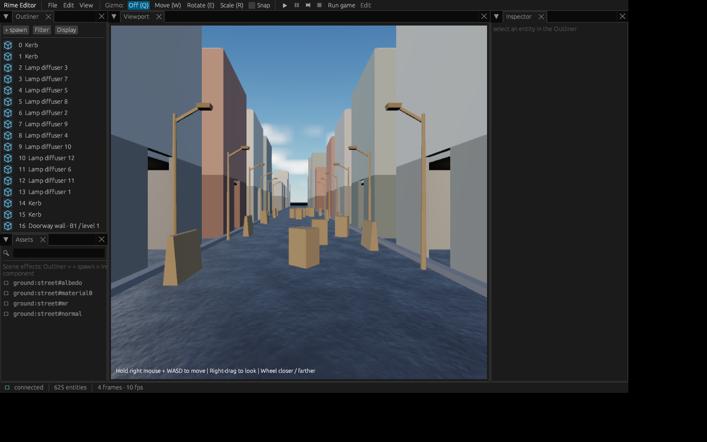
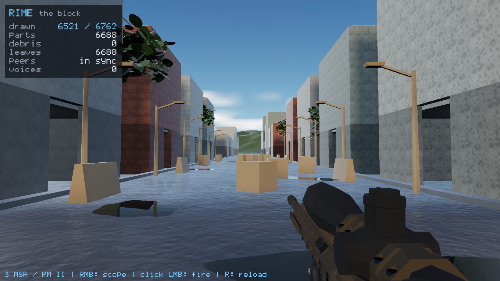

# City editor → saved map → game → development export

2026-10-19. Branch `feat/city-editor-play-launch`, parent `9702423` (#342).
Implementation `aa2720e`. Functional day-end checkpoint; no merge or performance
qualification. Source, binary, scene, manifest and captured image hashes are in
[provenance.json](provenance.json).

## What works

`./scripts/city-editor.sh` opens the persistent `build/release/city-editor.rscene`.
It has **625 entities, 569 destructibles, 32 buildings, 12 lamps and 8 barriers**.
The same generator and procedural pattern definitions feed editor and runtime.
The GUI's **Run game** confirms a save before launching the existing player and
weapons in a separate window. Failed/stale saves cannot launch. Closing the editor
leaves the game independent. City outliner roles show actual part names and
building/level, including reserved lamp/barrier tags, with compact List/Tiles icons.

The final exported development folder is:
`/home/next/rime-exports/city-demo-2026-10-19`.
Its binary provenance binds clean tracked implementation `aa2720e` to the copied
executable. Manifest SHA-256:
`f58514e4655dd132da0f7369dadc4a5ea3c3a325dddde0297ef5deb5e13d7022`.
Run `./the_block` inside it, with the sibling content/notices/manifest retained.
No editor, Python, Conan or checkout is needed at runtime. This is Linux x86_64
and records this host's ABI requirements; a clean second-machine release is unproven.

## Verification and limits

- Full Release build passes. Final CTest **93/94** (82.50 s); the inherited
  `the_block_headless` fails the same three collapse locality/extent claims.
  No solver/threshold/performance gate was changed or waived.
- The new GPU-free city test proves deterministic generation, overwrite refusal,
  real strict pattern binding, changed placement digest after a map edit, and
  unknown-pattern refusal. Existing scene tests and palette save/reload checks pass.
- Rust workspace tests pass with four existing ignores. Final GUI **134/134**,
  default and GUI all-target Clippy with `-D warnings`, format, license headers,
  shell/Python syntax, and existing bundle tests **32/32** pass.
- Actual compile-database Clang checks pass for main/host/city and palette/test/
  courtyard TUs. ASan/UBSan instrumented main/host/city objects load the CPU scene
  with leak detection; instrumented palette+blockkit tests pass **7 cases / 302
  assertions** with leak detection. Linked engine libraries remain the Release
  build: this is changed-TU sanitizer evidence, not a full sanitizer preset.
- Actual native Rust GUI on an owned `xvfb-run -a` display: File Save, Run game,
  a real weapon-window capture, then fresh reopen reconstructing **569 previews**,
  **0 missing roles/patterns**, **625 / 1858 authored entities/components**, no
  saved MeshRef/MaterialRef. Separate instrumented-host GUI save/run/reopen also
  passes (GPU leak detection off for the established driver policy). Some direct
  keyboard injections on Xvfb did not deliver Save reliably; final proof uses the
  visible File menu. This is not evidence of a product keyboard-shortcut defect.
- Real courtyard viewport save/reopen retains **155 entities / 0 skipped** without
  renderer IDs. This corrects a gap in the prior courtyard headless-save evidence.
- Final copied binary executes with `/home` and repository hidden via bwrap:
  strict scene/pattern load, then an actual Vulkan/Xvfb window, all three held
  weapon topologies loaded, **4 frames / 24 ticks / exit 0**, screenshot produced.
  This is software Vulkan functional evidence, not hardware frame-rate evidence.
- Existing export refuses without replacement; explicit wrong content and hidden
  content refuse with no checkout fallback; changed payload and escaping cooked
  target refuse; restored final bundle verifies against the pinned manifest hash.

## Failures that changed the work

The real viewport save exposed missing `DerivedComponents` tags in the palette and
courtyard preparer: it baked temporary draw indices into a 3004-component city.
That could retain intact meshes behind fractured parts. The existing writer's tag
mechanism now excludes those refs; authored roles and direct legacy untagged refs
retain their intended behavior. Root review also ensured authored-material reads
happen before structural archetype moves; a regression covers the meshed-prop path.

`asan-editor-host.log` retains the initial generic smoke failure: the corrupted
map produced zero reconstructed previews, and its brightest RGB pixel was sky,
which cannot yield a mesh pick. The RGB heuristic was not weakened for this brick.
Actual GUI saves/reopens and explicit isolated runtime execution provide the final
proof. `initial-build-failure.log` retains the first content-root link failure,
subsequently fixed by linking the existing app_game seam.

## Independent consultation

Astra **$0.02713**, Fable **$0.05224**, total **$0.07937**, matching live key usage
delta. Both recommended confirmed save before direct argv launch, shared game code,
portable content and explicit development scope. Astra's single serialized save
owner/fresh-result boundary was adopted. Fable suggested request IDs or serialized
ownership and baking ordinary city previews; root chose serialized ownership and
preview meshes reconstructed from the game's same procedural definitions. Baking
process-local refs would be incorrect; the consultation did not establish a stable
baked content format. Root owns all implementation, hunk review and verification.

The final native editor was also opened on the desktop with the persistent city,
using RTX 3060: 625 / 1858 loaded, 0 skipped, 569 reconstructed previews and
0 missing roles/patterns. That window is left ready for the user; no desktop
screenshot was published. This is functional startup, not a performance run.

Browser UI/deployment, in-viewport player possession, reusable prefabs, friendly
entity-reference picking, persistent custom names, animation authoring and GUI
Export remain future work. Existing physics locality/performance gates stay open.

Reproduce with `./scripts/city-editor.sh`, `./scripts/export-city.sh NEW-DIRECTORY`,
`ctest --test-dir build/release --output-on-failure -j 2`, and
`cargo test --manifest-path tools/Cargo.toml -p editor --features gui`.
The copied verification scripts use their original `/home/next/reports/...`
scratch layout and absolute artifact paths. Copy them to scratch before rerunning;
do not generate binaries/logs in tracked evidence. Full scratch:
`/home/next/reports/rime-city-editor-launch-2026-10-19/`.
