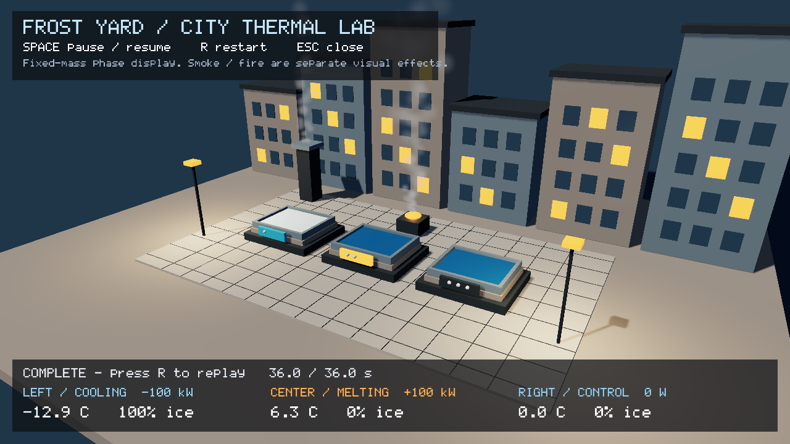

# Frost Yard demo verification — 2026-10-18

Branch `feat/thermal-courtyard-demo`, parent `feat/thermal-editor-authoring`
06d16dad8cda4ff37341a0d0c6a314b81e7a54e7, draft #340. Implementation and evidence
are separate commits; final handoff identifies the implementation. Nothing merged.

Run the [working demo](../../../samples/thermal-courtyard/README.md):

```sh
./scripts/thermal-courtyard.sh
# or the same saved scene in the native editor:
./scripts/thermal-courtyard.sh --editor
```

Space/P pauses, R restarts, Esc closes. Three stations cool, melt and hold an
insulated control. The sample pauses itself at 36 simulated seconds. The explicit
heat sources are separate from existing cosmetic fire and chimney smoke. Default
authoring is inert; this scene explicitly opts in to thermal/VFX/presentation.
The browser remains the existing streamed-play shell; no browser thermal editor
or new browser deployment was implemented/proven in this brick.



## Measured results

| Check | Result |
| --- | --- |
| Full RelWithDebInfo build | pass |
| New adapter/pixel tests | 3 cases / 4,789 assertions, pass |
| ASan/UBSan GPU-inclusive checks, CI GPU policy `detect_leaks=0` | 3 cases / 4,789 assertions, pass |
| CPU adapter tests with leak detection enabled | 2 cases / 616 assertions, pass |
| Actual-flag Clang | adapter/test/sample/host/renderer pass; final sample sources rechecked |
| Full Rust workspace / GUI editor | pass; GUI 122, 4 existing workspace ignored tests |
| Exact default and GUI Clippy, format, license, whitespace | pass |
| Full lavapipe CTest | **92/93**, exit 8, 293.71 seconds |
| Saved scene 36-second numerical selftest | pass, 2,160 ticks, authored data unchanged |
| Actual Application input: Pause/Resume/R restart | pass |
| Real viewport host: 120 steps + Pause/Stop/new Play | pass |
| Engine-owned save then fresh-process viewport reopen | pass, 155 entities / 317 components / 0 skipped |
| Installed SDK consumer including phase adapter | pass |
| Native RTX 3060 functional capture | pass, zero thermal refusals |
| Native Wayland window / own Xvfb X11 window | both present and capture successfully |
| Source-disabled control station | unchanged after all 2,160 ticks |
| Disabled required station in scratch scene | safe refusal, exit 2 |

The only full-suite failure is the same inherited `the_block_headless` three
collapse/locality claims; no assertions/thresholds changed. The input check passes
in the full run and in a separately owned Xvfb run. The full-suite command set
DISPLAY=:99 but retained WAYLAND_DISPLAY; it does not establish isolated X11.
`window-verify.py` explicitly removes Wayland, launches its own unused Xvfb display,
asserts an actual presented window, runs the input check, and terminates **only its
own** server. This corrects the earlier authoring brick's backend interpretation.

## Physical state and visible control

At 36 seconds, cooling is fully frozen at **260.236 K**, heating fully liquid at
**279.491 K**, and the unheated control stays liquid at **273.150 K**. Each cell
has fixed 10 kg mass; cooling/heating powers are explicitly -/+100,000 W. The
constant sources complete latent plateaus before the sample's duration pause;
that pause is not a clamp, thermostat, numerical retry or energy sink. Repeated
Play reconstructs the same first-step energies through the real editor host.

The renderer test uses actual accepted cooling, not manually assigned phase.
Ice versus water center radiance is **0.423309 / 0.063166**, over the >2 sensitivity
threshold. The water stays blue despite a red edit of caller storage after the
setter (copy ownership). Shared-material neighbor pixels remain exactly equal.
Clearing, stale generation, duplicate/capped/nonfinite input restore exact
baseline pixels, with TAA/jitter disabled. Authored material registry factors do
not change. Binding disable and invalid/reset graphs clear output; failed
numerical steps retain the previous accepted appearance. Source arrays, not
timer-based colours, feed both standalone and editor presentation.

The fixed mesh only changes opaque RGB/roughness. It does not establish flowing
water, refraction, ice volume/thickness, displacement, collision or breakage.
Cosmetic fire has no automatic heat/fuel/spread/damage authority. The diorama is
not the authoritative gameplay city and has no new shipment/network proof.

## Sanitizer and runtime qualifications

The sanitizer instruments new adapter/test plus SceneRenderer, ThermalPreview
and all three numerical thermal TUs; other linked engine libraries are ordinary
release archives. The initial leak-enabled GPU run (`asan-tests.log`) passed its
assertions but returned 1 for **368 bytes / 3 unresolved external-module leak
allocations**. It is retained, not silently discarded. Final GPU checks follow
existing CI's documented `ASAN_OPTIONS=detect_leaks=0`; CPU cases separately pass
with detect_leaks=1. No whole-engine leak-free or all-platform claim follows.
Copy `verify.py` to scratch before running: it writes objects/binary beside itself.

Headless captures advance numerical fixed ticks without rendering intermediate
frames, then render three presentation frames. Native capture is functional,
not a hardware performance benchmark. RTX 3060 driver 615.78.08 passes this
example; clocks/driver qualification and M18 budget remain open. No performance
comparison was run beside builds/CI.

Windowed captures follow actual framebuffer size (native compositor produced a
969×1025 tiled capture; owned Xvfb 1280×720). The copied camera override preserves
horizontal overview in a narrow window without mutating authored camera settings.
The initial requested-size capture assumption was corrected and rerun before
delivery. `window-native.png` and `window-x11.png` are the resulting frames.
Small sample capture/lens/status refinements received focused final build,
Clang, input/capture and numerical checks after the boundary full suite; no
unrelated whole-suite repeat. `provenance.json` hashes the final sources/binaries.

## Consultation, review and next work

One narrow tool-free Astra consultation, live availability/pricing checked first,
backgrounded. Response and exact gateway usage delta both **$0.03271**. Adopted
transient per-frame appearance, committed-state lifecycle, neighbor/stale pixel
controls. Chose whole-entity RGB/roughness factors instead of arbitrary PBR and
per-slot bindings; fixed palette/source descriptions instead of a new endpoint or
schedule API. See [ADR-0095](../../adr/0095-transient-phase-surfaces-and-courtyard.md).
Root performed all edits and adversarial hunk-by-hunk self-review; consultation
was a design proposal, not final code review. No new Fable call; previous thermal
research remains applicable. Private account/credential snapshots are excluded.

M18, city convergence, flowing-water mass/energy transport, geometric ice,
combustion authority, clicked asset/thermal creation, export and multiplayer
proofs remain open. A native Rust inspector is present; a browser inspector is
not. No deployment or merge occurred. This is the requested working day-end
example and a bounded continuation point.

Scratch: `/home/next/reports/rime-thermal-courtyard-2026-10-18/`.
All PNGs are direct rendered PPM-to-PNG conversions without retouching. The two
companion readmes document actual commands; external CI status is recorded in
the final handoff, separately from these local results.

Final PR snapshot: draft [#341](https://github.com/LucaSct/rime/pull/341), with
small station-label scaling polish verified on the actual narrow native window.
Parent #340 SDK/TSan/lint pass; ASan cancelled; Linux in progress at snapshot.
Its Editor-smoke job 117795067317 fails only the inherited three block claims
in the saved block roundtrip (filtered actual log retained). New child CI is
pending; hosted draft jobs can be skipped. No external green or merge claimed.
