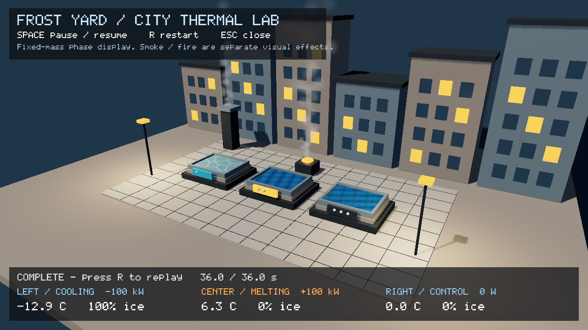
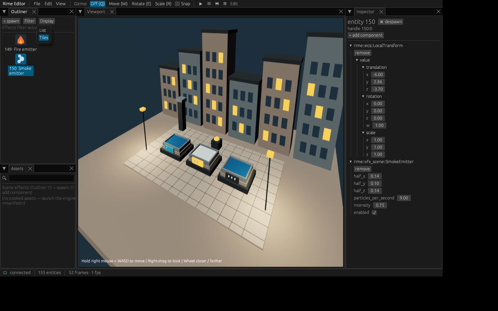

# Thermal detail and editor discovery — 2026-10-19

Parent a1fc1d2, branch feat/thermal-ripples-and-editor-navigation. Functional
checkpoint; no merge/performance/shipment qualification. See
[ADR-0096](../../adr/0096-committed-phase-detail-and-editor-discovery.md) and
[creator guide](../../creator-workflow.md).

- Full RelWithDebInfo build: passed, checked exit 0.
- Full CTest: **92/93**, exit 8, 89.15 s. Only the inherited three block
  collapse/locality claims in `the_block_headless` fail. No threshold changes.
- Adapter/render tests: **5 cases / 7142 assertions**, including accepted variable
  dt, retained cosmetic clock on numerical refusal, real forward/G-buffer water
  motion, frozen/paused exactness, split-plane submeshes, shared-material neighbor
  exactness, invalid scale and authored-factor restoration. Motion sensitivity
  reported 307/307 changed upper/lower pixels (308/308 instrumented). This supports
  visible motion; the regional count alone is not a triangle-identity oracle.
- ASan/UBSan: same 5/7142 pass with GPU leak detection disabled per existing CI
  policy; CPU-only **3/631** pass with leak detection enabled. Instrumented detail,
  adapter, test, renderer, preview and numerical TUs; other archives uninstrumented.
  No injected allocation/upload failure proof: the RHI upload API has no result.
- Actual compile-database Clang syntax: seven TUs pass, including new phase_detail.
- Rust workspace tests pass (four existing ignored); GUI **128 tests** pass,
  including semantic role precedence over MeshRef, bodyless source move/undo,
  held-right-drag movement, wheel routing, filters and accessible icon selection
  across List/Tiles. Default + GUI Clippy with warnings denied, format/license pass.
- Real saved courtyard host: 155 entities/317 components/0 skipped, Step/Pause/
  Stop/new Play smoke passes with live phase detail; standalone endpoint and real
  Application Pause/Resume/Restart checks pass. Native RTX 3060 functional capture
  has 2160 ticks/zero refusal. It is not a hardware performance benchmark.
- Actual GUI was launched with the script's host/scene arguments. A separate
  owned Xvfb display ran the GUI; xdotool selected Effects, Tiles and the actual
  smoke icon. Inspector shows source transform/settings. Captures show the menu
  and selected icon; no user desktop capture is published. Own processes stopped.

The user's launcher succeeded; navigation confusion was releasing right mouse
before WASD. No translation bug was reproduced. Hold guidance, wheel dolly and
owned-drag continuation improve usability. Editor stream remains fixed 960×540
and stretched to its panel. No browser UI/deployment, prefab library, persistent
custom names or rendered mesh thumbnails were added. Icons are crisp vector type
symbols (20 px list / 32 px tiles), and runtime values never become authored data.

Astra independent design consultation cost **$0.03019**, matching the live key
usage delta. Adopted immutable maps/private overrides, explicit resource lifetime,
fallback and accepted-duration clock. Root chose nine static tint maps to make
frost veins visible rather than deferring all base detail. Root owns edits/tests.
The 74 immutable mipmapped maps cost ~6.5 MB plus backend overhead and initialize
once per editor host, even without enabled thermal surfaces. No new geometry,
shader ABI, refraction, water transport or ice collision authority is claimed.

Reproduce with `cmake --build --preset release`,
`ctest --test-dir build/release --output-on-failure -j 2`,
`cargo test --manifest-path tools/Cargo.toml -p editor --features gui`, and
`./scripts/thermal-courtyard.sh --editor`. The source/binary/capture hashes are in
provenance.json. Copy verify.py/gui-capture.py to scratch before running to avoid
writing logs/binaries into tracked evidence. Scratch:
`/home/next/reports/rime-thermal-ripples-2026-10-19/`.
